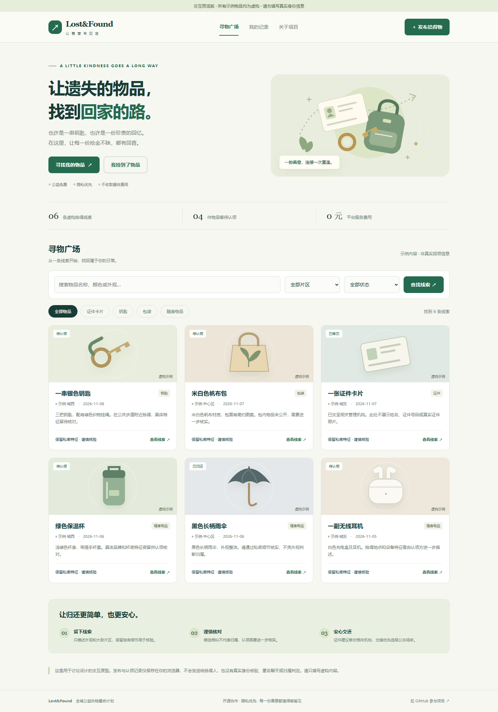

# Lost&Found - 全域公益失物撮合平台

> 开源公益项目，无商业收益，不售卖硬件 Tag，不接入公安户籍系统。
>
> 项目发起背景：基于日常生活中多次捡到遗失物品的真实体验，理解失主焦急的心情，希望搭建一个通用的失物信息撮合渠道。
>
> **当前仓库仅为项目创意方案 + 极简演示 Demo，安全性、校验逻辑不完善，不可以直接上线给公众使用。** 本仓库主要用于寻找愿意参与开发、维护的公益开发者。以下功能和约束为开发目标，不代表演示代码已经实现。

## 手机端与下一步开发

计划增加微信小程序、地图定位选址，以及可保存并由用户分享到朋友圈的物品海报。目标是让拾得人少打字、少操作，尽快留下有效线索。

详见 **[手机端与微信小程序开发需求](docs/mobile-product-plan.md)**：包含发布流程、页面清单、位置公开范围、分享海报内容、开发顺序与完成标准。

这些能力目前处于需求设计阶段，**尚未实现**。当前可体验的是下方的中文网页原型。

## 页面预览

新版中文交互原型已加入仓库。下载项目后双击 `index.html`，或者运行 `python preview.py`，即可查看和操作。图片仅为界面截图，不是已上线的网站。



## 核心痛点

市面上现有的失物招领系统大多是垂直场景：地铁、火车站、机场、校园独立分开。很多丢失物品的人无法确定遗失地点，很难逐个平台查询。

1. 捡到身份证、驾驶证等证件后，拾得人往往缺少合适的联系渠道。
2. 捡到钥匙、文件、背包、雨伞等无标识物品后，即便有心归还，也很难找到失主。
3. 缺少隐私友好的匿名沟通渠道，双方不希望直接暴露手机号、微信。
4. 证件等物品建议及时向当地公安机关或相关管理机构咨询、移交；平台仅作为辅助信息登记、匹配的补充渠道。

## 产品设计方案

### 两类物品分开处理流程

#### A. 证件类（身份证、社保卡、驾驶证等）

- 可登记字段：物品类型、捡到时间、大致片区、姓氏、户籍地地市、证件尾 4 位（可选）、经过打码后的外观照片。
- 禁止收集：完整身份证号、完整姓名、精确住址、生日。
- 检索方式：失主填写对应信息，系统返回一批候选记录。
- 认领核验：失主提交只有自己才知道的私密特征，核验通过后开启匿名站内消息。私密信息不得公开；可信核验方式及其权限设计仍需开发者完善，不能仅凭提交申请判定归属。
- 状态标记：支持标记“已移交派出所”，可以上传打码后的回执照片。

#### B. 无标识随身物品（钥匙、文件、背包、水杯等）

- 登记信息：物品大类、捡到时间、片区、外观标签、打码照片；文件类要求遮挡内部文字，仅拍摄外包装。
- 检索方式：按时间、片区、物品标签筛选候选池，系统只做推荐，不自动判定物品归属。
- 认领核验：依靠物品独有的私有细节，核验通过后开启匿名沟通。

### 配套机制

1. 匿名消息通道：平台内沟通，双方不直接暴露联系方式；交接方式支持面交、邮寄，运费由双方自行协商。
2. 自愿悬赏模块：仅展示文字悬赏声明，平台不托管资金、不提供支付链路；禁止以报酬作为归还物品的条件。
3. 激励体系：设置积分、电子勋章，无现金、无商品兑换；可探索同片区优先曝光，以及导出平台活动记录。活动记录不等同于经有资质机构认定的志愿服务证明。
4. 范围排除：本版本不包含蓝牙 Tag、防丢硬件售卖、分销带货相关功能。

## 安全与隐私开发要求（演示代码尚未实现）

1. 数据库禁止存储完整身份证号、详细住址、完整生日、完整姓名；自由文本同样需要限制与检查。
2. 图片上传需要脱敏，抹除敏感文字，原始图片不长期保存；自动脱敏需有复核机制。
3. 记录生命周期：已归还或超过 6 个月无人认领的记录，应按数据保留策略删除个人信息；归档不等同于删除。
4. 本项目没有公安身份核验权限，不对接户籍系统。
5. 平台定位为信息撮合通道，登记真实性、物品纠纷、悬赏纠纷和邮寄风险的处理规则仍需完善；项目说明不排除依法应承担的责任。

## 本地演示

### 直接体验中文页面（推荐）

双击仓库里的 `index.html` 即可在浏览器打开，无需安装依赖。GitHub 的文件页面展示的是源代码，不会直接运行 HTML；请下载仓库后在本地打开。

也可以使用 Python 3 启动仅供本机访问的预览，自动打开浏览器：

```sh
python preview.py
```

启动后访问 http://127.0.0.1:8000 ，关闭预览程序后该地址不再可用。预览服务器仅提供页面，不公开项目目录或数据库文件。

本版包含：

- 适配电脑和手机的中文首页、六条虚构示例和物品插画。
- 按关键词、片区、类别、状态筛选，查看物品线索详情。
- 发布虚构拾得线索，体验认领申请，查看“我的记录”。
- 对本浏览器发布的虚构线索标记待认领、已移交和已归还。
- 页面文本安全转义、基本字段限制和号码/联系方式提醒。提醒不等同于完善的敏感信息识别。

**这是独立的前端交互原型。** 体验数据只保存在当前浏览器的 localStorage；没有账号、跨设备同步、真实发布、私密聊天或核验服务。认领中的虚构私密特征在提交后不保存。清除浏览器数据会清除体验记录。示例统计不代表平台真实用户或运营成果。

### 旧版后端演示（供开发者参考）

建议使用 Python 3.10 或以上版本，在项目目录中执行：

```sh
python -m venv .venv
# Windows PowerShell：.venv\Scripts\Activate.ps1
# macOS / Linux：source .venv/bin/activate
python -m pip install -r requirements.txt
python -m uvicorn main:app --host 127.0.0.1 --port 8000
```

`main.py` 的首页现提供上述交互原型；原型没有连接旧版表单接口。原有 `/publish`、`/search` 等接口仍仅供代码参考，包含登记、简单检索和提交认领申请功能。旧接口尚未实现身份认证、认领核验、匿名消息、图片脱敏、数据删除和状态流转，也存在输入校验、HTML 输出转义及列表字段对应等问题。直接运行 `python main.py` 会监听所有网络接口，因此本地演示请使用上述仅监听本机的命令。

## 开源协议

采用 MIT License，详见 LICENSE。项目以公益为发起宗旨；MIT 协议本身允许商业使用，不附加“禁止商用”限制。

**仓库只放方案和代码，请勿上传真实证件、真实物品隐私资料、联系方式或未脱敏照片。**
